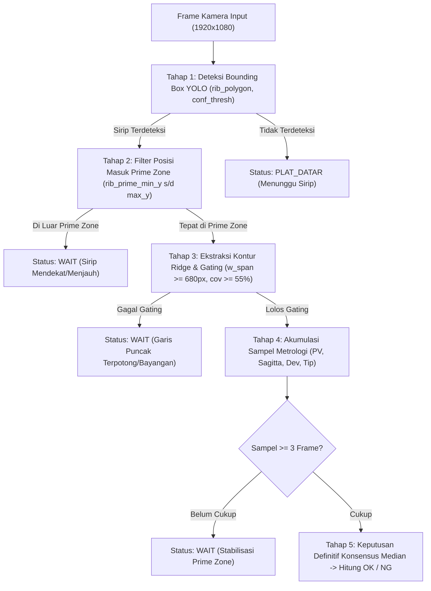

# PANDUAN LENGKAP TUNING PARAMETER INSPEKSI RIB (SIRIP) KONVEYOR

Dokumen ini merupakan panduan teknis operasional untuk melakukan kalibrasi dan *parameter tuning* pada subsistem inspeksi bilah sirip (**Top Inspection Slat Rib**). Gunakan panduan ini apabila terjadi anomali inspeksi di lapangan, seperti bilah sirip tidak terhitung (*uncounted*), status macet di `WAIT`, pembacaan salah (*false NG / false OK*), atau ketika posisi kamera/pencahayaan konveyor mengalami pergeseran fisik.

---

## DAFTAR ISI
1. [Alur Kerja Pipeline Deteksi Sirip](#1-alur-kerja-pipeline-deteksi-sirip)
2. [Tabel Diagnostik Cepat Masalah & Solusi](#2-tabel-diagnostik-cepat-masalah--solusi)
3. [Parameter Konfigurasi JSON (`top_inspection_config.json`)](#3-parameter-konfigurasi-json-top_inspection_configjson)
   - [3.1. `rib_prime_min_y` & `rib_prime_max_y` (Zona Prime Evaluasi)](#31-rib_prime_min_y--rib_prime_max_y-zona-prime-evaluasi)
   - [3.2. `rib_conf_threshold` (Sensitivitas AI YOLO)](#32-rib_conf_threshold-sensitivitas-ai-yolo)
   - [3.3. `rib_polygon` (Area Batas Inspeksi Konveyor)](#33-rib_polygon-area-batas-inspeksi-konveyor)
   - [3.4. Ambang Batas Metrologi Cacat Kelurusan (`PV`, `Sagitta`, `Dev`, `Tip`)](#34-ambang-batas-metrologi-cacat-kelurusan-pv-sagitta-dev-tip)
4. [Parameter Logika Inti Python (`hybrid_rib_inspector.py`)](#4-parameter-logika-inti-python-hybrid_rib_inspectorpy)
   - [4.1. Gating Bentang Puncak (`full_span_valid`)](#41-gating-bentang-puncak-full_span_valid)
   - [4.2. Syarat Konsensus Sampel Minimum (`sample_count`)](#42-syarat-konsensus-sampel-minimum-sample_count)
   - [4.3. Jarak Pelacakan Antar-Bilah (`Spatial Centroid Continuity`)](#43-jarak-pelacakan-antar-bilah-spatial-centroid-continuity)
5. [Prosedur Standar Penyetelan di Lapangan (SOP 5 Menit)](#5-prosedur-standar-penyetelan-di-lapangan-sop-5-menit)

---

## 1. Alur Kerja Pipeline Deteksi Sirip

Sistem mengevaluasi bilah sirip melalui 5 gerbang hierarki berurutan:



Jika salah satu dari tahapan di atas gagal memenuhi syarat, sirip **tidak akan pernah divonis atau dihitung**, melainkan terus tertahan pada status `WAIT`.

---

## 2. Tabel Diagnostik Cepat Masalah & Solusi

| Gejala pada Tampilan Layar | Penyebab Teknis | Parameter yang Harus Diubah | Rekomendasi Tindakan |
|---|---|---|---|
| **Kotak Bounding Box AI tidak muncul** saat sirip lewat | Confidence YOLO di bawah ambang akibat cahaya redup/sudut miring | `rib_conf_threshold` | Turunkan dari `0.55` ke `0.45` atau `0.40`. |
| **Pesan: "Plat datar melintas"** padahal ada sirip di layar | Sirip melintas di luar batas poligon yang diizinkan | `rib_polygon` | Perlebar koordinat vertikal $Y$ pada poligon konveyor. |
| **Pesan: "Stabilisasi Prime Zone (0/3 sampel)"** terus-menerus | 1. Ketinggian bilah (`Top Y`) di luar rentang Prime.<br>2. Bentang kontur (`Span`) lebih kecil dari syarat minimum. | 1. `rib_prime_min_y` & `max_y`<br>2. `full_span_valid` (`w_span`) | 1. Geser jendela Prime ke nilai `Top Y` aktual.<br>2. Turunkan ambang `w_span` jika kamera dijauhkan. |
| **Pesan: "Stabilisasi Prime Zone (1/3 atau 2/3 sampel)"** lalu hilang tanpa tercounting | Kecepatan konveyor tinggi sehingga sirip transit terlalu singkat | `rib_prime_min_y` & `max_y` | Perlebar jendela Prime (misal dari tinggi 120px ke 160px). |
| **Sirip lurus tapi divonis BENGKOK (NG)** | Efek tekstur las kasar atau getaran konveyor terhitung sebagai defleksi | `rib_sagitta_threshold` / `rib_pv_threshold` | Naikkan ambang batas toleransi sebesar $+1.0$ s/d $+2.0\text{ px}$. |
| **Sirip bengkok lolos LURUS (OK)** | Ambang toleransi terlalu longgar | `rib_sagitta_threshold` / `rib_dev_threshold` | Turunkan ambang batas toleransi sebesar $-1.0$ s/d $-2.0\text{ px}$. |

---

## 3. Parameter Konfigurasi JSON (`top_inspection_config.json`)

File konfigurasi ini terletak di:  
[`Vision_Engine_Core/02_Top_Inspection_Slat_Rib/configs/top_inspection_config.json`](file:///c:/File%20Rayidha/Internship/Project/5.%20Project%20AI%20Slat%20Rib%20Conveyor/Program/Vision_Engine_Core/02_Top_Inspection_Slat_Rib/configs/top_inspection_config.json)

### 3.1. `rib_prime_min_y` & `rib_prime_max_y` (Zona Prime Evaluasi)

* **Lokasi di JSON**: `thresholds` -> `"rib_prime_min_y"`, `"rib_prime_max_y"`
* **Nilai Default Optimal**:
  ```json
  "rib_prime_min_y": 340,
  "rib_prime_max_y": 460
  ```
* **Fungsi**:
  Menentukan batas ketinggian piksel vertikal ($Y$) tempat sampel metrologi dikumpulkan. Di zona inilah lensa kamera memiliki distorsi terendah dan pencahayaan paling merata.
* **Kapan Harus Diubah**:
  1. **Kamera digeser naik/turun**: Jika kamera dinaikkan atau diturunkan, ketinggian bilah sirip saat melintas akan bergeser.
  2. **Konveyor melaju lebih cepat**: Jika sirip melintas terlalu cepat sehingga hanya tertangkap 1–2 frame di dalam zona.

> [!TIP]
> **Contoh Kasus Lapangan:**
> - **Kondisi**: Kamera sedikit dimiringkan ke bawah. Pada tampilan dashboard tertulis:  
>   `Sirip melintas | Top Y=495px | Stabilisasi Prime Zone (0/3 sampel)`
> - **Analisis**: Puncak sirip berada di $Y=495\text{ px}$, sedangkan batas maksimum Prime Zone hanya sampai $460\text{ px}$. Akibatnya, sampel tidak pernah dihitung.
> - **Solusi Tuning**: Ubah konfigurasi menjadi:
>   ```json
>   "rib_prime_min_y": 420,
>   "rib_prime_max_y": 540
>   ```

---

### 3.2. `rib_conf_threshold` (Sensitivitas AI YOLO)

* **Lokasi di JSON**: `thresholds` -> `"rib_conf_threshold"`
* **Nilai Default Optimal**:
  ```json
  "rib_conf_threshold": 0.55
  ```
* **Fungsi**:
  Menentukan skor probabilitas minimum ($0.0 - 1.0$) agar model AI YOLO menganggap objek sebagai bilah sirip.
* **Kapan Harus Diubah**:
  - **Lampu Dimmer Redup / Kondisi Gelap**: Turunkan ke `0.45` atau `0.40`.
  - **Banyak False Positive**: Jika celah antar-plat slat sering salah terdeteksi sebagai sirip, naikkan ke `0.60` atau `0.65`.

> [!TIP]
> **Contoh Kasus Lapangan:**
> - **Kondisi**: Lampu kerja ruangan dimatikan atau dimmer disetel rendah. Kotak pembatas AI sering berkedip (*flicker*) atau hilang saat sirip melintas.
> - **Solusi Tuning**: Turunkan threshold di config:
>   ```json
>   "rib_conf_threshold": 0.42
>   ```

---

### 3.3. `rib_polygon` (Area Batas Inspeksi Konveyor)

* **Lokasi di JSON**: `"rib_polygon"`
* **Nilai Default Optimal**:
  ```json
  "rib_polygon": [
    [0.06, 0.28],
    [0.94, 0.28],
    [0.94, 0.65],
    [0.06, 0.65]
  ]
  ```
* **Fungsi**:
  Membatasi poligon region-of-interest (ROI) dalam fraksi koordinat layar ($0.0 - 1.0$).
  - Titik atas ($Y=0.28 \approx 302\text{ px}$ pada Full HD) memotong bagian rol atas konveyor.
  - Titik bawah ($Y=0.65 \approx 702\text{ px}$ pada Full HD) **sangat krusial untuk membuang balok chassis bawah konveyor** ($Y \approx 800 - 900\text{ px}$) agar tidak dibaca sebagai sirip palsu.
* **Kapan Harus Diubah**:
  - Jika dudukan kamera bergeser ke kiri/kanan, sesuaikan fraksi $X$ ($0.06$ dan $0.94$).
  - Jangan menaikkan batas bawah melebihi $0.70$ kecuali kamera diangkat sangat tinggi, guna mencegah AI terkunci pada rangka besi bawah.

---

### 3.4. Ambang Batas Metrologi Cacat Kelurusan (`PV`, `Sagitta`, `Dev`, `Tip`)

* **Lokasi di JSON**: `thresholds`
* **Nilai Default Optimal**:
  ```json
  "rib_pv_threshold": 14.0,
  "rib_sagitta_threshold": 11.5,
  "rib_dev_threshold": 8.5,
  "rib_tip_threshold": 9.5
  ```
* **Fungsi Setiap Parameter**:

| Parameter | Nama Metrologi | Definisi Fisik & Toleransi |
|---|---|---|
| **`rib_sagitta_threshold`** | **Sagitta Parabola** | Mengukur defleksi lengkungan busur bilah (parabola $y = ax^2 + bx + c$). Parameter utama untuk mendeteksi bilah sirip membengkok/melengkung akibat benturan atau tarikan las. |
| **`rib_pv_threshold`** | **Peak-to-Valley (PV)** | Selisih ketinggian antara titik paling menonjol (puncak) dengan titik paling cekung (lembah) terhadap garis baseline ($98^{\text{th}} - 2^{\text{nd}}$ persentil). |
| **`rib_dev_threshold`** | **Inner Body Deviation** | Deviasi deviasi maksimum pada badan tengah bilah (mengecualikan 75px di ujung bilah). |
| **`rib_tip_threshold`** | **Tip Deviation** | Deviasi lokal khusus pada kedua ujung bilah (jarak 75px dari tepi kiri & kanan) untuk mendeteksi ujung sirip somplak atau tertekuk. |

> [!NOTE]
> Nilai di atas berskala piksel optik. Dengan resolusi Full HD ($1920\times1080$), faktor skala nominal adalah $\approx 0.515\text{ mm/px}$.
> Artinya `rib_sagitta_threshold = 11.5 px` setara dengan toleransi kelengkungan $\approx 5.9\text{ mm}$.

---

## 4. Parameter Logika Inti Python (`hybrid_rib_inspector.py`)

File logika inspeksi berada di:  
[`Vision_Engine_Core/02_Top_Inspection_Slat_Rib/src/hybrid_rib_inspector.py`](file:///c:/File%20Rayidha/Internship/Project/5.%20Project%20AI%20Slat%20Rib%20Conveyor/Program/Vision_Engine_Core/02_Top_Inspection_Slat_Rib/src/hybrid_rib_inspector.py)

### 4.1. Gating Bentang Puncak (`full_span_valid`)
* **Baris**: 1220 – 1225
* **Kode**:
  ```python
  full_span_valid = (w_span >= 680.0 and coverage >= 0.55)
  ```
* **Fungsi**:
  Mencegah fitting parabola semu. Jika kontur sirip terputus atau hanya terdeteksi sepotong (misal $< 680\text{ px}$), perhitungan matematis Sagitta akan melipatgandakan nilai kelengkungan secara palsu. Dengan gating ini, sistem menolak menghitung metrologi sampai bilah terlihat utuh.
* **Kapan Perlu Diatur**:
  - Jika kamera dipasang lebih jauh atau sudut *field of view* (FOV) membuat sirip tampak lebih pendek di layar (misal panjang sirip hanya $\approx 600\text{ px}$), turunkan nilai `680.0` ke `550.0`.

---

### 4.2. Syarat Konsensus Sampel Minimum (`sample_count`)
* **Baris**: 1307 – 1315
* **Kode**:
  ```python
  if sample_count < 3:
      status = "WAIT"
  ```
* **Fungsi**:
  Memastikan vonis OK/NG diambil berdasarkan **konsensus nilai median dari minimal 3 frame** berurutan. Ini menolak *glitch* sesaat seperti percikan cahaya atau serpihan debu.
* **Kapan Perlu Diatur**:
  - Nilai `3` adalah *sweet spot* terbaik untuk konveyor berkecepatan $15-30\text{ cm/s}$.
  - Jika konveyor bergerak sangat lambat ($< 5\text{ cm/s}$), Anda dapat menaikkannya ke `5` untuk presisi yang lebih tinggi.

---

### 4.3. Jarak Pelacakan Antar-Bilah (`Spatial Centroid Continuity`)
* **Baris**: 833 – 885
* **Kode**:
  ```python
  # Toleransi pelacakan bilah yang sama: |ΔY| <= 45 px
  if dist <= 45: ...
  
  # Deteksi transisi bilah baru:
  if delta_y > 45 or (curr_cy - self._last_active_cy) > 30:
      self._reset_rib_session()
  ```
* **Fungsi**:
  Membedakan bilah yang sedang berjalan dengan bilah baru yang baru masuk di belakangnya.
  - Nilai toleransi `45 px` menjamin bilah yang sama tetap terlacak saat bergerak.
  - Jika centroid melompat $> 45\text{ px}$ atau melompat mundur $> 30\text{ px}$, sistem secara otomatis mereset sesi metrologi dan menyiapkan nomor urut bilah baru (`Rib #N+1`).

---

## 5. Prosedur Standar Penyetelan di Lapangan (SOP 5 Menit)

Jika operator mendapati sirip konveyor tidak terhitung saat sistem dijalankan, lakukan 4 langkah berikut:

```
[Langkah 1: Observasi HUD]
   Perhatikan tulisan status di layar inspeksi saat sirip berada tepat di tengah.
   Catat 3 nilai penting:
   * Top Y  : [misal: 415 px]
   * Span   : [misal: 760 px]
   * Samples: [misal: 0/3 sampel]

[Langkah 2: Evaluasi Masalah]
   * Jika Top Y = 415 px, tetapi config prime adalah [360, 400], maka sirip di luar jangkauan.
   * Jika Span = 620 px, tetapi gating menuntut >= 680 px, maka sampel ditolak.

[Langkah 3: Buka & Sunting Konfigurasi]
   Buka file: Vision_Engine_Core/02_Top_Inspection_Slat_Rib/configs/top_inspection_config.json
   Sesuaikan rentang prime:
   "rib_prime_min_y": 340,
   "rib_prime_max_y": 460

[Langkah 4: Simpan & Verifikasi]
   Simpan file (Ctrl + S). 
   Sistem akan langsung memuat konfigurasi baru dan bilah sirip akan segera divonis OK/NG secara otomatis!
```

---
*Dokumen ini diperbarui secara berkala dan telah tervalidasi pada pengujian multi-frame konveyor reversibel & forward.*
