# Alur Kerja Sistem Inspeksi Slat & Rib Conveyor
### Pure Computer Vision — Metrologi Flatness (Peak-to-Valley)

---

## 🗺️ Diagram Alur Lengkap

```mermaid
flowchart TD
    A([📷 Input: Foto Benda Kerja]) --> B

    subgraph FASE1["FASE 1 — PERSIAPAN ROI"]
        B[User klik 4 titik\npada SIRIP/RIB] --> C
        C[User klik 4 titik\npada PLAT DASAR/SLAT] --> D
        D[Tekan ENTER\nMulai Analisis]
    end

    D --> E

    subgraph FASE2["FASE 2 — PRE-PROCESSING FILTER"]
        E[Crop Bounding Box ROI] --> F1
        F1["① Grayscale\nBGR → 1 channel"] --> F2
        F2["② CLAHE\nPerkuat kontras lokal 8×8 blok"] --> F3
        F3["③ Bilateral Filter\nHapus noise/karat\njaga ketajaman tepi"] --> F4
        F4["④ Sobel-X + Sobel-Y\nGradien isotropik semua arah\n→ grad_mag"] --> F5
        F5["⑤ Binary Threshold\ngrad > 35 → Putih\ngrad ≤ 35 → Hitam"] --> F6
        F6["⑥ Morphology Close 13×5\nSambung garis putih terputus"] --> F7
        F7["AND dengan mask polygon\n→ clean_edges_masked ✅"]
    end

    F7 --> G

    subgraph FASE3["FASE 3 — EKSTRAKSI KONTUR (GARIS BIRU)"]
        G["Scan per Kolom (tiap 2px)\nCari piksel putih paling ATAS\ndi setiap kolom X"] --> H
        H["Kumpulkan koordinat\nraw_x, raw_y"] --> I
        I["Corner Trimming 6%\nBuang ujung kiri & kanan\n(area baut/chamfer)"] --> J
        J["Median Filter kernel-9\nHapus outlier/titik loncat"] --> K
        K["Moving Average window-7\nHaluskan zig-zag\n→ clean_x, clean_y"]
    end

    K --> L

    subgraph FASE4["FASE 4 — GARIS ACUAN IDEAL (GARIS KUNING)"]
        L["Ambil titik pertama & terakhir\ndari clean_x, clean_y"] --> M
        M["Garis lurus:\n(x1,y1) ──────── (x2,y2)\nUjung kiri → Ujung kanan"]
    end

    M --> N

    subgraph FASE5["FASE 5 — PENGUKURAN DEVIASI (GARIS MERAH)"]
        N["Hitung Perpendicular Distance\nd = ((y2-y1)·X - (x2-x1)·Y + x2·y1 - y2·x1) / span_len"] --> O
        O["Deviasi setiap titik (piksel):\n(+) = biru di ATAS kuning\n(-) = biru di BAWAH kuning"] --> P
        P["Cari titik PALING KRITIS\n→ argmax(|perp_dist|)"] --> Q
        Q["Gambar garis merah:\ntitik biru → proyeksi ke kuning"]
    end

    Q --> R

    subgraph FASE6["FASE 6 — PENILAIAN OK / NG"]
        R["PV Flatness =\nmax(deviasi) − min(deviasi)"] --> S
        S{PV > Threshold?}
        S -- "❌ YA" --> T1["STATUS: NG\nBENGKOK / BERGELOMBANG\nCetak ke terminal"]
        S -- "✅ TIDAK" --> T2["STATUS: OK\nRATA\nCetak ke terminal"]
    end

    T1 --> U
    T2 --> U
    U["Tampilkan overlay visual\ndi jendela OpenCV"] --> V
    V{Foto berikutnya?}
    V -- "D / A (navigasi)" --> A
    V -- "R (reset ROI)" --> B
    V -- "ESC / Q" --> W([🔚 Program Selesai])
```



---

## 📋 Penjelasan Per Fase

### FASE 1 — Persiapan ROI
User menandai **2 area poligon** secara manual:
- **ROI 1 (SIRIP/RIB):** Klik 4 sudut mengelilingi sirip konveyor
- **ROI 2 (PLAT DASAR/SLAT):** Klik 4 sudut mengelilingi plat dasar

> [!NOTE]
> Poligon (bukan persegi panjang biasa) dipilih agar dapat mengikuti bentuk benda yang miring di foto.

---

### FASE 2 — Pre-Processing Filter

| Tahap | Nama | Input → Output | Tujuan |
|-------|------|----------------|--------|
| ① | Grayscale | BGR warna → Abu-abu 1 channel | Hapus info warna, fokus intensitas |
| ② | CLAHE | Abu-abu → Kontras diperkuat | Tepi yang samar jadi tajam, tahan pencahayaan tidak merata |
| ③ | Bilateral | Gambar → Noise berkurang | Hapus tekstur karat tanpa merusak tepi benda kerja |
| ④ | Sobel X+Y | Gambar halus → Peta gradien | Deteksi perubahan intensitas dari semua arah (termasuk diagonal) |
| ⑤ | Threshold | Gradien → Hitam-Putih | Sederhanakan ke biner: putih = tepi, hitam = bukan tepi |
| ⑥ | Morph Close | Garis putus-putus → Garis sambung | Tutup celah akibat karat/lubang agar tepi kontinyu |
| Mask | AND Polygon | Gambar full → Area ROI saja | Buang deteksi di luar area yang dipilih user |

**Hasil akhir fase ini:** `clean_edges_masked` — gambar biner, putih = tepi fisik benda kerja

---

### FASE 3 — Ekstraksi Kontur → 🔵 Garis Biru

```
Untuk setiap kolom X (kiri → kanan, step 2px):
   Lihat kolom pada clean_edges_masked
   Temukan piksel PUTIH paling atas
   Simpan koordinat (X, Y)

→ Hasilnya: ~400-500 titik koordinat menyusuri tepi atas benda kerja
```

**Pembersihan koordinat:**
1. **Corner Trimming 6%** — buang titik di ujung (efek baut/chamfer)
2. **Median Filter k=9** — hapus titik yang loncat tiba-tiba (spike)
3. **Moving Average w=7** — haluskan fluktuasi kecil

---

### FASE 4 — Garis Acuan Ideal → 🟡 Garis Kuning

```
Titik awal  = clean_x[0],  clean_y[0]   (ujung kiri kontur)
Titik akhir = clean_x[-1], clean_y[-1]  (ujung kanan kontur)

Garis kuning = garis lurus penghubung titik awal → titik akhir
```

> [!IMPORTANT]
> Garis kuning bukan regresi linear biasa. Ia menghubungkan ujung-ke-ujung agar merepresentasikan **"seandainya benda lurus sempurna dari satu ujung ke ujung lainnya"** — ini lebih sesuai untuk inspeksi kerataan industri.

---

### FASE 5 — Pengukuran Deviasi → 🔴 Garis Merah

**Rumus Perpendicular Distance (Jarak Tegak Lurus):**

```
span_len = √((x2-x1)² + (y2-y1)²)    ← panjang garis kuning

d = ((y2-y1)·Xᵢ - (x2-x1)·Yᵢ + x2·y1 - y2·x1) / span_len
              ↑                    ↑
       koordinat titik biru    konstanta garis kuning
```

Hasilnya adalah **jarak bertanda (piksel)**:
- `d > 0` → titik biru di atas garis kuning (melendut ke atas)  
- `d < 0` → titik biru di bawah garis kuning (melendut ke bawah)
- `d = 0` → titik biru tepat di garis kuning (sempurna)

**Garis merah** digambar hanya di titik dengan `|d|` terbesar (titik paling kritis).

---

### FASE 6 — Penilaian OK / NG

```
Peak-to-Valley (PV) = max(d) − min(d)

Contoh:
  Titik paling melendut ke atas  = +12 px
  Titik paling melendut ke bawah = -5  px
  PV = 12 − (−5) = 17 px

  Threshold SIRIP  = 15 px → 17 > 15 → ❌ NG
  Threshold PLAT   = 18 px → 17 < 18 → ✅ OK
```

---

## 🎛️ Parameter yang Dapat Dikonfigurasi (FILTER_CONFIG)

| Parameter | Default | Fungsi |
|-----------|---------|--------|
| `CLAHE_CLIP_LIMIT` | 2.5 | Kekuatan penguatan kontras |
| `BILATERAL_D` | 7 | Radius filter noise karat |
| `SOBEL_THRESH` | 35 | Kepekaan deteksi tepi |
| `MORPH_KERNEL_SIZE` | (13,5) | Kemampuan menutup celah garis |
| `CORNER_TRIM_PCT` | 0.06 | Persentase ujung yang dipotong |
| `THRESH_SIRIP_NG` | 15.0 px | Batas toleransi kelengkungan sirip |
| `THRESH_SLAT_NG` | 18.0 px | Batas toleransi kelengkungan plat |

> [!TIP]
> Semua parameter diatas dapat dioptimalkan menggunakan `Benchmark_Filter_Slat_Rib.py` untuk mendapatkan nilai terbaik pada kondisi foto/pencahayaan tertentu.
